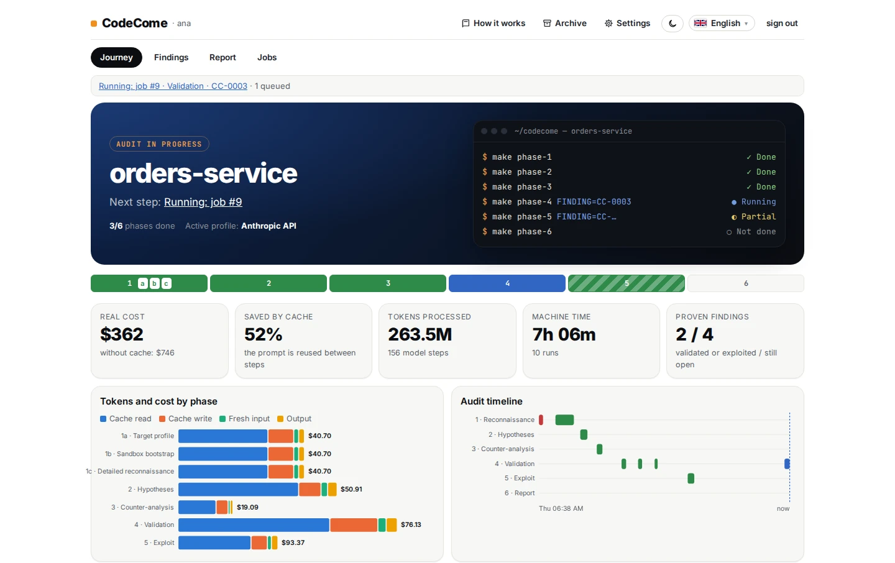
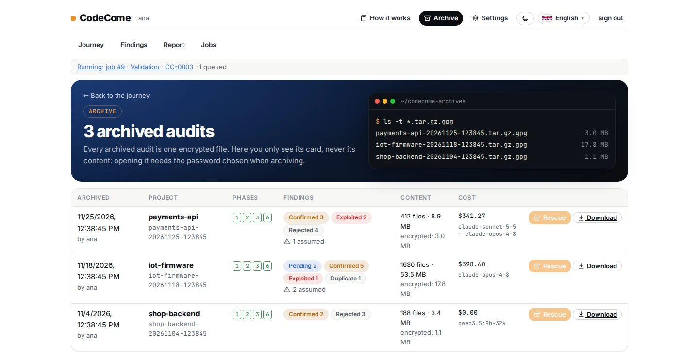
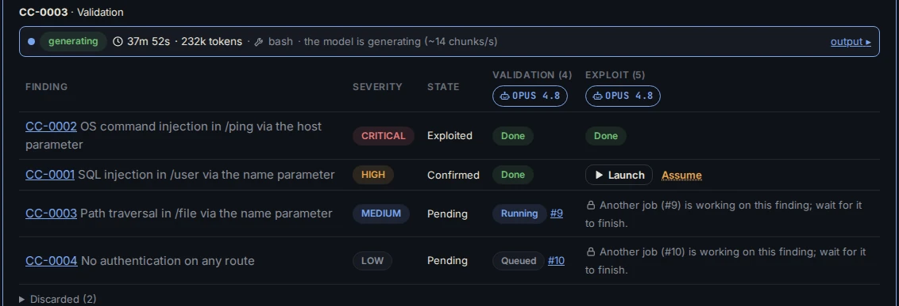
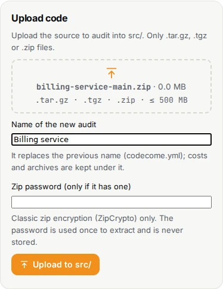

# CodeCome Web

A web interface for [CodeCome](https://www.codecome.ai/) ([source](https://github.com/pruiz/CodeCome)),
the AI-assisted vulnerability research workspace.
It turns CodeCome's phases into a guided journey: launch each phase, watch it work live, review
the findings, read and print the report, replay exploit recordings, and keep a history of finished
audits as encrypted archives. All the work is still done by CodeCome; this project never changes it.




**▶ [A 30-second tour](media/codecome-web-1.1-spot.mp4)** (video, no sound). Screenshots and video
use invented demo data.

- **Journey** — the six phases (recon, hypotheses, counter-analysis, validation, exploit, report)
  as one page: what is done, what can run next and why not, live progress of the running job,
  and the per-finding matrix for phases 4 and 5. **It is the only place where anything is launched.**
- **Findings, Report, Jobs** — read-only views. The report renders CodeCome's Markdown safely,
  with a PDF print layout and a raw Markdown download. Exploit recordings play in a built-in
  terminal player.
- **"Assume"** — accept a finding without validating or exploiting it, with a required reason
  that goes into the report.
- **Costs** — tokens, cache savings, machine time and cost per phase, read from opencode's
  transcripts and priced from `config/prices.json`.
- **Archive** — encrypt the whole audit (code, notes, findings, evidence, reports, job history)
  into one file (GnuPG, AES-256), verify it, empty the workspace, and rescue it later.
- **Upload code** — `.tar.gz` / `.zip` (optionally ZipCrypto-encrypted) through a hardened extractor.
- **How it works** — an illustrated explanation of the method, for people new to the tool.
- Seven languages (en, es, de, fr, ca, gl, eu), light and dark themes, HTTPS out of the box.

<table>
  <tr>
    <td width="50%"></td>
    <td width="50%"></td>
  </tr>
  <tr>
    <td><sub><b>Archive</b> — one encrypted file per audit, its cost and the models it used (the last one ran on a local model, $0).</sub></td>
    <td><sub><b>Phases 4 · 5</b> — validation and exploit per finding, live job, "Assume" with a reason (dark mode).</sub></td>
  </tr>
</table>

## Contents

- [Requirements](#requirements) · [Install](#install) · [After installing](#after-installing)
- [Architecture](#architecture) · [Security model](#security-model)
- [Development](#development) · [Limitations](#limitations) · [Roadmap](ROADMAP.md) · [License](#license)

## Requirements

- **Debian or Ubuntu** with systemd (tested on Ubuntu 24.04), Python **3.12+**.
- **CodeCome**, already installed and working: see [github.com/pruiz/CodeCome](https://github.com/pruiz/CodeCome).
  The installer asks
  where it is *first* and stops without changing anything if it is not there.
- **Docker**, used by CodeCome's sandboxes (the installer can install the distribution's package).
- For model phases: an API key (e.g. Anthropic) and/or a local model server (e.g. Ollama), as
  CodeCome itself needs.

## Install

From the unpacked source tree:

```bash
sudo ./install.sh
```

It asks, in this order: where CodeCome is, where CodeCome Web goes (default `/opt/codecome-web`;
a path under `/home` works too), where data and archives go, which users run the two services
(new ones are created by default, existing ones can be used), the certificate's IP and names, the
port (default **8100**), and the first administrator's password. Then it does everything else:
system packages, users and group, ACLs where needed, the virtualenv, systemd units, a local HTTPS
certificate authority, and a health check. It prints the URL and the CA's fingerprints at the end.

- **Re-running it upgrades** the installation (it remembers the answers in a manifest).
- **Non-interactive:** `sudo ./install.sh --yes --admin NAME --admin-password-file FILE [options]`;
  see `./install.sh --help` for every option (`--codecome`, `--prefix`, `--web-user`, `--ip`, …).
- **Uninstall:** `sudo /opt/codecome-web/uninstall.sh` keeps data, archives, the CA and the users;
  add `--purge` to remove everything it created. It never removes system packages or touches CodeCome
  (except the ACLs the installer added).

## After installing

**Trust the local CA once per browser.** Open `https://<ip>:8100/ca.crt`, accept the one-time
warning to download it, and install it as a trusted **root** authority. Check the fingerprint the
installer printed.

- *Windows (Edge, Chrome):* double-click the file → Install certificate → Current user →
  **"Place all certificates in the following store"** → **Trusted Root Certification Authorities**.
  Letting Windows choose the store puts it under "Intermediate" and the browser keeps saying
  "Not secure". Windows shows the SHA-1 fingerprint. Restart the browser.
- *macOS:* Keychain Access → System → import → open it → Trust → *Always Trust*.
- *Firefox* (own store, any OS): Settings → Privacy & Security → Certificates → View Certificates →
  Authorities → Import → trust it to identify websites.
- The CA is **name-constrained**: it can only vouch for this host's IP and names, nothing else.

**API keys** live only in the worker's `worker.env` (0600, e.g. `/var/lib/codecome/worker.env`),
never in the web: add `ANTHROPIC_API_KEY=…` there and `sudo systemctl restart codecome-worker`.

**Models and profiles** are chosen in *Settings* by an administrator (`config/profiles.json`,
created from [config/profiles.example.json](config/profiles.example.json), lists what can be chosen).

**More web users:**
`sudo -u codecomeweb env CODECOME_USERS=/opt/codecome-web/data/users.json /opt/codecome-web/.venv/bin/python /opt/codecome-web/tools/adduser.py NAME`
(administrators are listed in `CODECOME_ADMINS` in the web unit).

**Renew the server certificate** (it lasts 825 days, the most browsers accept):
`sudo /opt/codecome-web/deploy/tls-setup.sh --renew` and restart `codecome-web`.

## Architecture

```
 browser ──HTTPS──▶ codecome-web (FastAPI, unprivileged)          codecome-worker (only process with Docker)
                     │ reads CodeCome's itemdb/, reports            │ takes one job at a time
                     │ enqueues jobs, never runs commands  ──jobs.db──▶ runs `make phase-N` in CodeCome
                     │ settings, users, ledger (read)               │ archive / rescue / upload (Python)
                     └──────────── shared data dir (SQLite WAL, logs, one-shot secrets) ──┘
```

- **Two services, two users.** The web cannot start processes, touch Docker or read API keys. It
  only enqueues jobs from a closed list (`phase-1…6`, plus archive/rescue/upload/reset). The worker
  builds the command itself (`make phase-N FINDING=CC-…`, never a shell) and publishes a real pulse:
  CPU, memory and I/O of the process group, opencode's transcript (tokens, retries) and the output.
- **CodeCome's files are the source of truth.** Phase status is derived from what is on disk
  (`itemdb/notes`, `findings/<STATUS>/`, `runs/`, reports) and CodeCome's own gates
  (`tools/gate-check.py`) decide what can be launched; the web adds only its own state (jobs,
  "assumed" marks, settings) in SQLite.
- **Front end without a build step.** Preact + htm (vendored, pinned by hash), ES modules served as
  is, a strict Content-Security-Policy (no inline scripts or styles), no `innerHTML`: everything the
  agents wrote is rendered as text.
- **Files:** `app/` (API and front end), `worker.py`, `tools/` (adduser, test LLM server, demo),
  `deploy/` (TLS setup, unit templates), `install.sh`, `uninstall.sh`, `tests/`.

## Security model



- **Agent output is untrusted.** Markdown is parsed to a tree of allowed tags (links limited to
  safe schemes); recordings are parsed into plain text; files are read with `O_NOFOLLOW`, size caps
  and an inside-the-workspace check; images are served only after a magic-byte check.
- **Sessions:** scrypt password hashes, an HMAC-signed `Secure; HttpOnly; SameSite=Strict` cookie,
  login rate limiting, an extra same-origin check on every state-changing request.
- **Admins vs auditors:** profiles, models, archiving, rescuing and uploading are admin decisions;
  the server enforces it, not only the UI.
- **Uploads:** type by content; extraction entry by entry by our own code (no `tar -x`/`unzip`):
  no absolute paths, `..`, links, devices or setuid; caps on entries, size and compression ratio;
  all-or-nothing.
- **Archives:** `gpg --symmetric` AES-256; the password reaches the worker through a one-shot file
  (never argv, environment, database or logs) and is **never stored**: a lost password means an
  unreadable archive. The workspace is emptied only after the archive has been decrypted again and
  checked file by file.
- **Hardening:** both services run with `NoNewPrivileges`, `ProtectSystem` and `ProtectHome`; the
  code is owned by root and read-only for them.

## Development

```bash
python3 -m venv .venv && .venv/bin/pip install -r requirements-dev.txt
.venv/bin/python -m pytest                       # unit, API and guard tests
tools/run-demo.sh                                # the UI with invented data on http://127.0.0.1:8199
CODECOME_USERS=demo/data/users.json .venv/bin/python tools/adduser.py tester   # a user for the demo
sudo tools/test-install-container.sh             # install.sh for real in a throw-away container
```

`tools/mock_llm.py` is an OpenAI-compatible fake model server for running phases without a GPU or
spending (used by the `mock` profile). Guard tests keep the licensing complete
(`tests/test_licensing.py`) and private data out of the code (`tests/test_public_clean.py`).
User-facing text lives only in `app/locales/*.json` (same keys in every language).

## Limitations

- Debian/Ubuntu only for now; one CodeCome workspace = one audit at a time (projects are on the
  roadmap); one worker runs one job at a time.
- The local CA covers the LAN case; a certificate of your own can replace the files in
  `/etc/codecome-web/tls` (an admin view for it is planned).
- Encrypted zip uploads: ZipCrypto only (git as source planned too).
- CodeCome Web is installed as an application directory with its own virtualenv, not as a pip package.

## License

Copyright (C) 2026 @jesusdml

Dual-licensed, like CodeCome, under your choice of the **GNU General Public License v3.0 or later**
or the **GNU Affero General Public License v3.0 or later** (`GPL-3.0-or-later OR AGPL-3.0-or-later`).
It is a network service: if you offer a modified version to others over a network, the AGPL asks you
to share its source. See [LICENSE](LICENSE), [AGPL-LICENSE](AGPL-LICENSE) and [NOTICE](NOTICE)
(third-party components: htm/Preact, Inter, JetBrains Mono, each with its own license).
